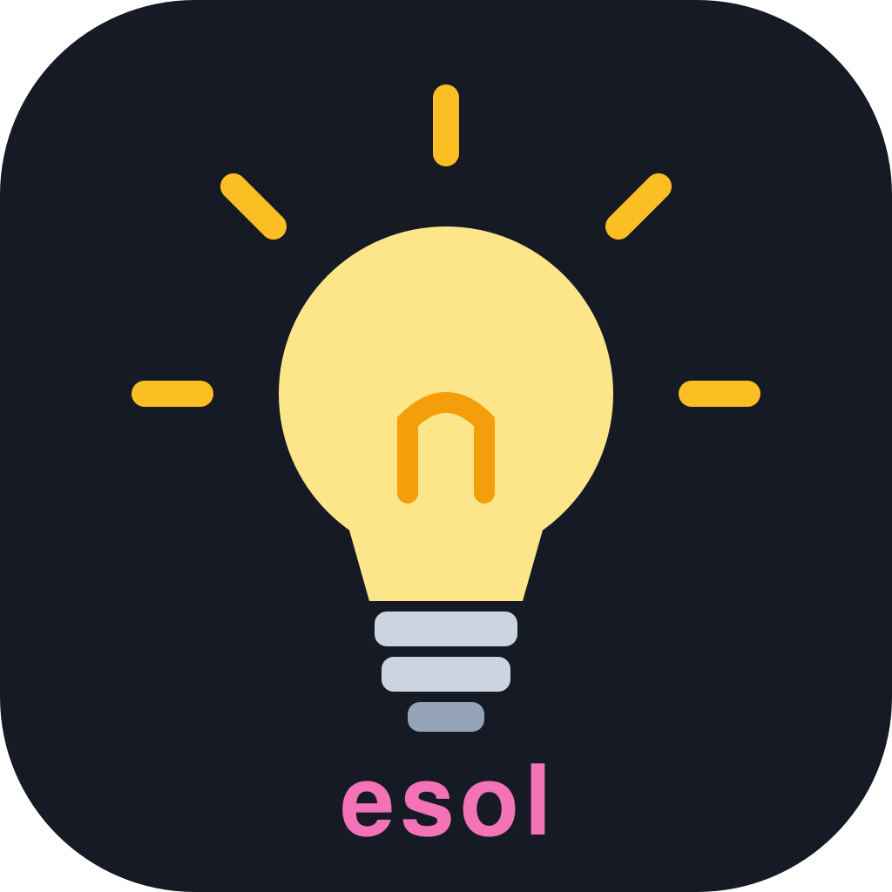
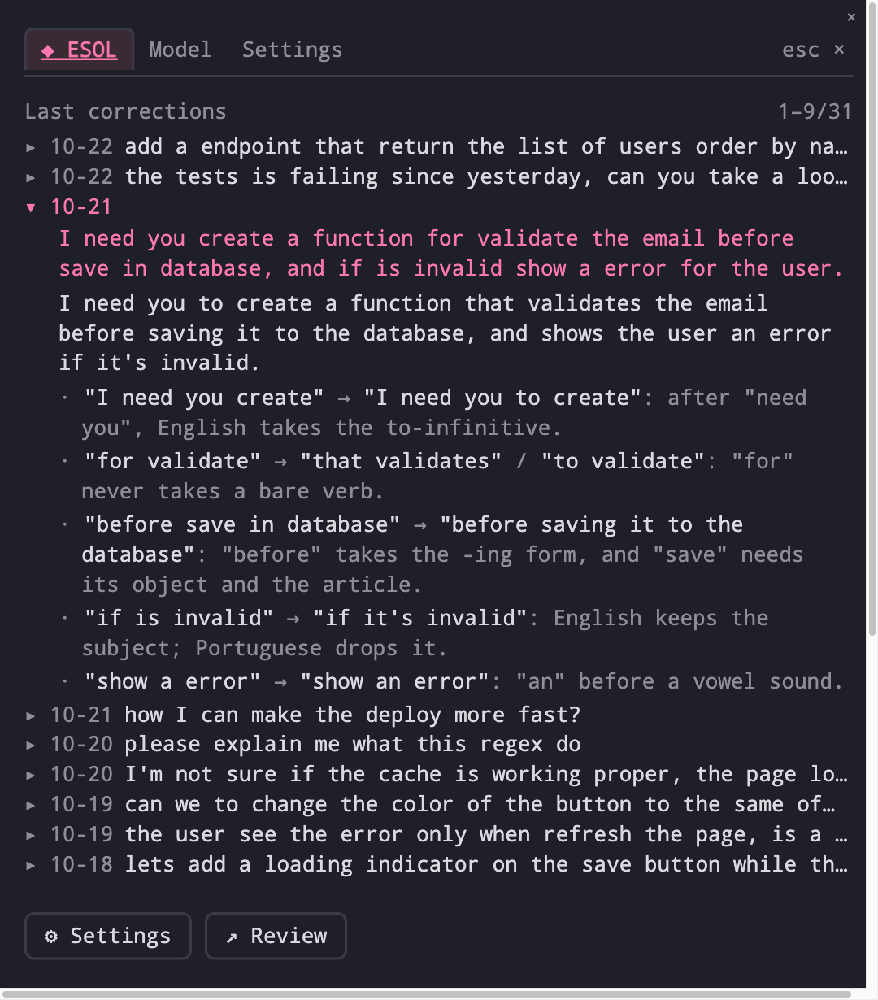
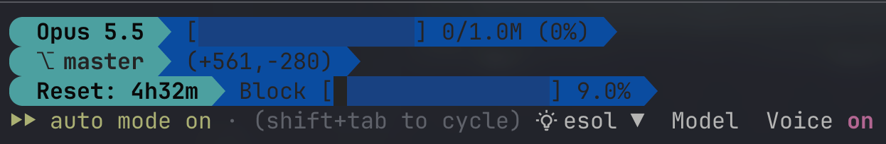
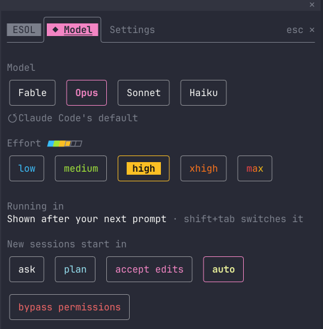
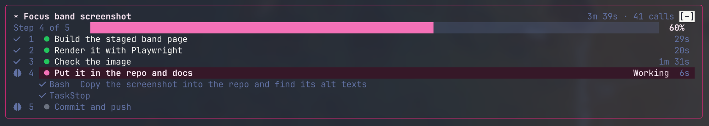
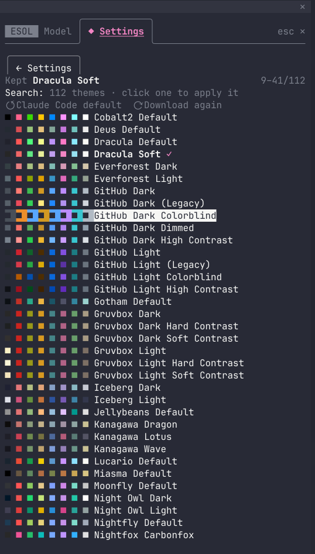
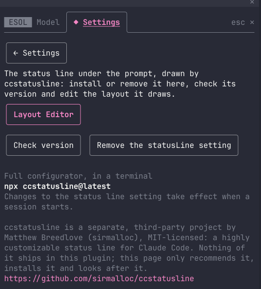
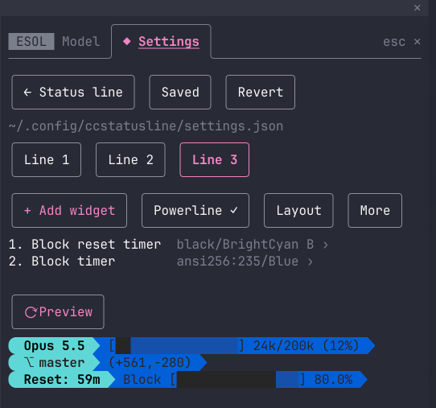
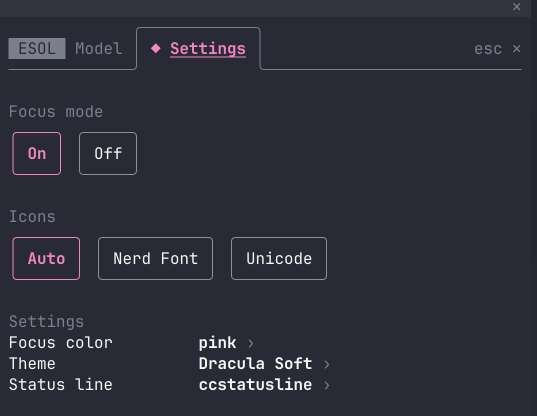

<p align="center"></p>

# cc-esol

<p align="center"><a href="README.md">English</a> · <a href="README.pt-BR.md">Português</a> · <a href="README.es.md">Español</a> · <b>中文</b></p>

*由英文 README 翻译而来，英文版为准。欢迎修正。*

**在每天使用 Claude Code 的过程中学英语。**

ESOL 是 *English for Speakers of Other Languages* 的缩写，意为“面向其他语言使用者的英语”。cc-esol 是 [Claude Code](https://claude.com/claude-code) 的一个侧边栏插件，内置一位被动的英语教练：你照常写 prompt，你打字或口述的英语会被纠正并写进一份学习日志，想看的时候再看。同一个侧边栏还提供 Focus 模式、终端主题、模型与 effort 控制、状态栏编辑器和语音开关。

## 工作方式

1. 打开侧边栏，在 ESOL 标签页把 coaching 设为 **On**，选择你的母语。
2. 你用英语写的每个 prompt 都和以前一样执行。Claude，也就是你正在对话的那个模型，会把它的地道英语版本连同原因写进一个本地文件：`~/.claude/english-learning/learning.md`。
3. 标签页按时间倒序列出你的纠正。**Review** 让模型读取日志并在标签页内作答：反复出现的模式、来自母语的干扰、这些问题是否在减少，以及三个练习。



用你母语写的 prompt 不会被处理，斜杠命令、简短回复（"yes"、"continue"）以及用其他文字书写的 prompt 也一样。已经地道的英语不会被记录。缩写中缺少的撇号（"dont"、"im"、"thats"）视为打字速度问题而忽略；用词选择（its/it's、your/you're、their/they're）会被纠正。英语 prompt 里夹着的一个母语单词被视为词汇空缺：条目会给出对应的英语说法。

## 开口说

练习最快的方式是口述。Claude Code 自带语音听写（`/voice`），角落按钮旁的 **Voice** 按钮负责开关并显示状态。教练纠正的是转录文本的英语，不是你的发音；识别器很可能听错的词会被标记为 `[STT?]`，而不算作语法错误。在 `/config` 里把听写语言保持为英语：用它说母语会得到乱码文本，这会推动你去说英语。

语音听写是 Claude Code 的功能，不是本插件的。它需要登录 claude.ai 账号（API key、Bedrock、Vertex AI 或 Foundry 下不可用）、本地麦克风（SSH 或网页版不可用）以及 Claude Code 2.1.69 或更新版本；转录本身不消耗 token。详见 [Claude Code 语音听写文档](https://code.claude.com/docs/en/voice-dictation)。

## 隐私与成本

**你的文字去了哪里**

- 日志是一个本地文件，`~/.claude/english-learning/learning.md`，默认所有项目共用。设置 `ENGLISH_COACH_LOG` 可以把它移到别处，比如一个会同步的笔记文件夹。插件自己不会把任何内容发送到任何地方。
- 纠正由你正在对话的模型写出，形式是对插件 `english_log` 工具的一次调用，它是你对话的一部分。你的 prompt 和它的纠正走的是本次会话使用的同一个 API，没有其他去处。
- **Review** 会把日志（最多最新的 150,000 个字符）在一次请求中发给模型，并把回答保存在插件的 store 里，即 `~/.claude/plugins/store/cc-esol_*.json` 这个 JSON 文件。`/cc-esol:english-review` 命令在对话记录中做同样的事，并列出每一条目。
- 要全部删除：删掉日志文件；删掉 store 文件可以丢弃保存的 review 和设置（coaching 回到 Off）。卸载插件不会动日志。

**它的成本**

- Themes、Model、Status line、Voice 和 Icons 不消耗 token：它们只读取 Claude Code 本来就会产生的信息，从不往请求里添加内容。Focus 关闭时没有任何开销：它的 `focus_progress` 工具在 ToolSearch 后面等待。开启时有三项开销：工具列表中的工具定义（约 1,200 个字符，与列表其余部分一起缓存）、你输入的每个 prompt 旁边一行 132 个字符的文字，以及 Claude 对该工具的调用：计划只发一次，之后每个步骤开始时只发送它的编号，并与该步骤的第一次工具调用放在同一条消息里，不单独发起请求。开启或关闭 Focus 会在下一回合重写一次 prompt 缓存。
- 插件从不修改 Claude Code 的 system prompt：它对 Claude 说的话随自己工具的描述以及你的 prompt 一起传送。
- ESOL 不是免费的。coaching 开启时，教练规则随插件自己的 `english_log` 工具的描述一起传送（连同描述其余部分不到 4,096 个字符），位于每次请求被缓存的工具列表中，而不在历史里。每个被纠正的 prompt 多带一行约 160 个字符，即门槛的测量结果。每次纠正是一次工具调用，参数是你的原文、改写和原因，这次调用会像其他调用一样留在对话里。coaching 关闭时什么都不会添加，工具退到 ToolSearch 之后等待。
- 用固定的十条 prompt 脚本在 coaching 关闭和开启、相同模型和版本下测量：见下文的 [实测成本](#实测成本)。

## 侧边栏的其余部分

点击右下角的 **💡 esol**，或输入 `/esol`（也可以 `/esol model`、`/esol settings`、`/esol themes`、`/esol focus`、`/esol statusline`、`/esol editor`）。三个标签页：**ESOL**、**Model**、**Settings**。**Tab** 移动，**Enter** 选择，**Esc** 关闭。角落按钮旁边，**Model** 直接跳到 Model 页面，**Voice** 切换听写。



### Model

模型（Fable、Opus、Sonnet、Haiku，或 Claude Code 的默认值）、从 low 到 max 的 effort，以及新会话启动时的权限模式。切换模型会运行 Claude Code 自己的 `/model`；effort 作用于每次请求并会被记住；当前会话的模式用 **shift+tab** 切换，这里的选择保存为 `permissions.defaultMode`。



### Focus

prompt 上方的一条横幅，显示任务标题、计时、进度条和步骤。Focus 开启时，在需要两次以上工具调用的任务开始前，Claude 会把计划发给横幅自己的工具 `focus_progress`，之后每个步骤开始时发送它的编号，所以每一行都会从待办变为进行中再变为完成；会话提供 todo 列表、task 工具或 plan mode 中批准的计划时，它们也会更新横幅。运行中的步骤下方显示最近几次工具调用的动态，按 Claude 自己的描述显示（"Read the settings page and its tests"）：点击某一行（或用 ctrl+x tab 移到它上面）可展开该调用执行的内容和输出的前几行，再点一次收起；这些调用会保留到你的下一个 prompt。Focus 开启时工具调用和结果从对话记录中隐藏，失败或被中断的调用除外；ctrl+o 可查看所有调用的完整内容。回合结束时若仍有待办步骤，横幅会暂停，被中断或出错的回合会显示出来；你的下一个 prompt 让它继续。`[–]` 把它收成一行。颜色：blue、dark、light、green、pink、rainbow，或自定义。



在全屏布局下，Claude Code 的三个未关闭 issue（[#102893](https://github.com/anthropics/claude-code/issues/102893)、[#104197](https://github.com/anthropics/claude-code/issues/104197)、[#104462](https://github.com/anthropics/claude-code/issues/104462)）可能让滚轮跳动，或让隐藏行上的最后一行闪烁。

### Themes

来自 [terminalcolors.com](https://terminalcolors.com) 的一百多个终端配色主题，一次性下载到 `~/.claude/cc-esol/themes/`。点击一个：Claude Code 的颜色随之改变（写入 `~/.claude/themes/cc-esol.json` 并在 `~/.claude/settings.json` 中设置；第一次需要重启一次，之后实时生效），终端背景也随之改变，在 Windows Terminal 上（仅本次会话，之后恢复）以及支持 OSC 颜色的终端上（Ghostty、iTerm2、kitty、WezTerm、Terminal.app）。**Claude Code default** 恢复原来的颜色。



### Status line 与 Layout Editor

Status line 页面负责安装、检查和移除 [ccstatusline](https://github.com/sirmalloc/ccstatusline)，一个第三方状态栏。Install 把 `statusLine` 块写入 `~/.claude/settings.json`（保留原有内容以便 Uninstall），并在没有配置时写入一份起始配置；你自己设置的状态栏会被显示出来，不会被改动。**Layout Editor** 就地编辑 `~/.config/ccstatusline/settings.json`：行、组件、颜色、powerline 和布局，并由你自己的状态栏命令绘制实时预览。Save 以同样方式试运行候选配置，备份文件，然后一步替换，不编辑的部分原样保留。详见 [docs/statusline.md](docs/statusline.md)。

<p>


</p>

### Settings

Focus 开关及其颜色、以名称显示为按钮的主题、状态栏，以及图标集（Nerd Font、Unicode，或 Auto：当你的 ccstatusline 配置绘制 powerline 时使用 Nerd Font，因此从不安装也不要求任何字体）。



## 要求与安装

Claude Code 2.1.299 或更新版本，macOS、Linux 或 Windows。在 2.1.306 上开发和测试。

```
claude plugin marketplace add rapha-rodrigues/cc-esol
claude plugin install cc-esol@esol --scope user
```

运行 `/reload-plugins` 或开启新会话，然后点击 **💡 esol** 或输入 `/esol`。更新：

```
claude plugin marketplace update esol && claude plugin update cc-esol@esol
```

**从 `--plugin-dir` 检出升级：** 插件的 store 按安装来源区分，所以从 marketplace 安装会以默认设置开始（coaching Off，没有保存的 review）。学习日志不受影响：它在 store 之外。

<details>
<summary><b>用 AI 代理安装</b></summary>

把你的编码代理指向本仓库，让它安装插件。代理的步骤：

1. 运行 `claude --version`；必须是 2.1.299 或更高。
2. 运行 `claude plugin marketplace add rapha-rodrigues/cc-esol`。
3. 运行 `claude plugin install cc-esol@esol --scope user`。
4. 确认 `claude plugin list` 显示 `cc-esol` 已启用，然后让用户运行 `/reload-plugins`。

在 Windows 的 Git Bash 中运行时，路径请使用正斜杠。

</details>

## 语言

ESOL 设置里有二十种语言可选，或选 **Other** 并输入名称。语言只告诉教练该留意哪种母语干扰；判断一个 prompt 是否为英语的门槛对你的语言一无所知，因此适用于任何语言。侧边栏本身使用英语。

## 实测成本

待补充：每次发布涉及教练文本的改动前，会用 [docs/releasing.md](docs/releasing.md) 中的十条 prompt 脚本在 coaching 关闭和开启下各跑一遍，并把 `/usage` 的读数连同模型和 Claude Code 版本发布在这里。

## 常见问题

- **没有出现任何条目。** 打开 ESOL 标签页的 Settings，确认 coaching 是 On。hook 在会话启动时加载：安装或更新后重启 Claude Code，或运行 `/reload-plugins`。
- **我母语的 prompt 被纠正了。** 它的英语单词达到了阈值（push、merge、fix 这类借词也算）。在 Settings 里调高阈值。Claude 看出一条消息不是英语时也会跳过它。
- **一条英语 prompt 没被纠正。** 它里面的日常英语单词太少（简短、满是术语的 prompt）。在 Settings 里调低阈值或最少词数。
- **Voice 按钮显示 `/voice` 不可用。** 用 claude.ai 账号登录（`/login`）；听写在 API key 或第三方提供商下不可用。
- **日志一直在变大。** 没有任何机制修剪它。重命名归档即可；下一条目会重新创建文件。超过 4 MiB 后标签页停止预览，Review 会要求先归档。
- **提示说 cc-esol 的某个 hook 被跳过。** 使用 Team 或 Enterprise 账号登录时，Claude Code 内置的防护（`cc-plugin-sec-default`）会把用户插件挡在 system prompt 和经典 hook 事件之外，并在对话记录中说明。cc-esol 建立在能通过的部分之上，因此 coaching、横幅和其余功能都按描述工作；唯一的损失是 Model 页面的 "Running in" 一行，它永远得不到当前的权限模式（shift+tab 仍可切换）。无需任何配置。
- 更多内容见 [docs/english-coach.md](docs/english-coach.md) 和 [docs/statusline.md](docs/statusline.md)。

## 开发

```
claude --plugin-dir ./plugins/cc-esol
claude plugin validate ./plugins/cc-esol
claude plugin test ./plugins/cc-esol
```

发布流程见 [docs/releasing.md](docs/releasing.md)；变更记录在 [CHANGELOG.md](CHANGELOG.md)。

## 许可与致谢

[MIT](LICENSE)。

[ccstatusline](https://github.com/sirmalloc/ccstatusline) 是 Matthew Breedlove 的独立项目，MIT 许可；本插件不包含它的任何内容，只是推荐、安装它并编辑它的配置。终端主题来自 [terminalcolors.com](https://terminalcolors.com)，在运行时应你的请求下载；本仓库同样不包含其中任何一个。
